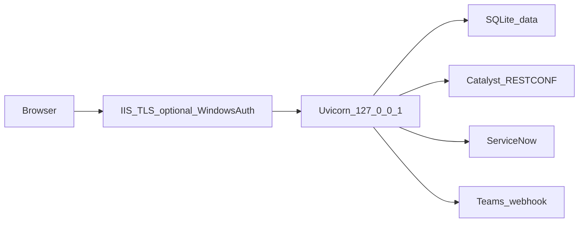

# Switcheroo architecture

Internal Client Services / Networks desk. One Windows host. Not a public SaaS.

## Pieces

- **Browser** — CS and Networks. Cookie session (`HttpOnly`, `SameSite=Lax`).
- **IIS (shared host)** — TLS terminator. Windows Authentication when `SWITCHEROO_AUTH=windows`. Proxies to loopback.
- **Uvicorn / FastAPI** — WinSW service `Switcheroo`. Poller in-process (status every 60–180s).
- **SQLite** — `data\switcheroo.db`. Device passwords are Fernet `enc:v1:`. User passwords are scrypt (or unusable `windows$` after JIT).
- **Launch Control** — out-of-band WPF/PowerShell monitor. Not on the request path.
- **ServiceNow / Teams** — dry-run unless explicitly enabled. Failures do not drop the local approval queue.

## Scale

Cookie sessions are share-nothing. Login lockout and the poller assume **one** worker. That matches one office of CS/Networks. Revisit if this becomes a region-wide CMDB (Postgres, a second instance, and a shared lockout store).

## Trust boundary

The app is not on the public internet. Bind `127.0.0.1` behind IIS, or `0.0.0.0` only with a host firewall. `SWITCHEROO_REQUIRE_HARDENED=true` fails startup when lab secrets, open CS grants, or an unsafe Windows-auth bind are still set.
